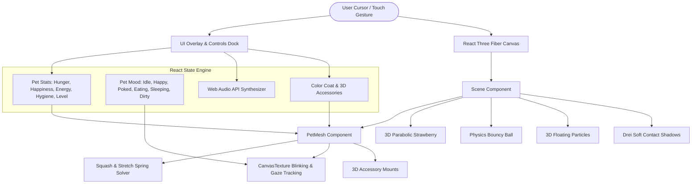

# 🐾 Maxy: Interactive 3D Web Pet Documentation

An ultra-cute, fully interactive 3D virtual pet built with **React Three Fiber (R3F)**, **Three.js**, **React 18**, and **TypeScript**. Maxy features squishy marshmallow/mochi physics, dynamic expressive eyes with real-time gaze tracking, modular 3D accessories, a Tamagotchi-inspired pet care system, 3D particle effects, synthesized Web Audio sound effects, and a mobile-responsive glassmorphism user interface.

---

## 📑 Table of Contents
1. [Overview & Highlights](#-overview--highlights)
2. [Technology Stack](#-technology-stack)
3. [System Architecture](#-system-architecture)
4. [Project Directory Structure](#-project-directory-structure)
5. [Core Engineering & Features](#-core-engineering--features)
   - [Squash & Stretch Spring Physics](#1-squash--stretch-spring-physics)
   - [Procedural Dynamic Face & Gaze Tracking](#2-procedural-dynamic-face--gaze-tracking)
   - [Modular 3D Accessories](#3-modular-3d-accessories)
   - [Tamagotchi Care & State Engine](#4-tamagotchi-care--state-engine)
   - [3D Particle System](#5-3d-particle-system)
   - [Web Audio API Sound Synthesizer](#6-web-audio-api-sound-synthesizer)
   - [Day / Night Ambient Lighting](#7-day--night-ambient-lighting)
6. [Mobile-First Responsive Design](#-mobile-first-responsive-design)
7. [Getting Started & Local Development](#-getting-started--local-development)
8. [Controls & Interaction Guide](#-controls--interaction-guide)
9. [Extensibility Guide](#-extensibility-guide)

---

## 🌟 Overview & Highlights

- **Squishy Mochi Body:** Built using Drei's [`<RoundedBox>`](file:///c:/Users/GIMINDU/Videos/Projects/maxy/src/components/PetMesh.tsx) with custom spring physics that dynamically compress and stretch while conserving volume upon clicking or poking.
- **Dynamic Procedural Face:** Rendered on an internal high-res HTML5 canvas texture featuring autonomous blinking, pupil gaze tracking following the cursor or finger touch, soft pulsing blush cheeks, and reactive mouth morphs.
- **Interactive Mini-Games & Actions:**
  - 🍓 **Feed:** Launches a 3D strawberry in a parabolic arc towards Maxy's mouth with eating chew animations and crumb particles.
  - 💖 **Pet / Rub:** Petting Maxy by dragging across the body triggers happy purr vibrations and floating 3D hearts.
  - 🎾 **Play:** Drops a physics-driven bouncy beach ball into the scene that can be launched and bounced around the floor.
  - 🧼 **Wash:** Spawns a multi-bubble soap bath that cleanses dirt spots and leaves Maxy sparkling clean.
  - 💤 **Sleep:** Dims the lighting, relaxes breathing rate, closes eyes, and gently emits floating 3D "Zzz" letters.
- **Wardrobe & Customizer:** Change mochi flavors (Marshmallow White, Sakura Pink, Mint Sorbet, Taro Mochi, Honey Butter, Peachy Cream) and equip 3D accessories (Royal Crown, Bunny Ears, Chef Hat, Cool Shades, Angel Halo, Sakura Flower).
- **Zero Audio Assets Required:** All audio effects (boings, squishes, munches, chords, lullabies, bubble pops) are synthesized mathematically using the standard Web Audio API.

---

## 🛠 Technology Stack

| Layer | Technology | Purpose |
|---|---|---|
| **Build Tool** | [Vite 5](https://vitejs.dev/) | Lightning fast HMR development and rollup bundle builds |
| **Framework** | [React 18](https://react.dev/) | Component architecture, state lifecycles, and hooks |
| **Language** | [TypeScript 5](https://www.typescriptlang.org/) | Strict type safety for stats, moods, and vector math |
| **3D Rendering** | [Three.js](https://threejs.org/) + [React Three Fiber](https://docs.pmnd.rs/react-three-fiber) | WebGL rendering loop, scene graph, and camera |
| **3D Helpers** | [@react-three/drei](https://github.com/pmndrs/drei) | RoundedBox geometry, ContactShadows |
| **Styling** | Vanilla CSS (CSS3) | Design tokens, glassmorphism, responsive grid & dock |
| **Audio** | Web Audio API | Zero-latency procedural sound synthesis |
| **Celebrations** | [canvas-confetti](https://www.npmjs.com/package/canvas-confetti) | Milestone and level-up burst effects |
| **Icons** | [Lucide React](https://lucide.dev/) | Sleek, modern iconography |

---

## 📐 System Architecture



---

## 📁 Project Directory Structure

```text
maxy/
├── index.html                   # HTML entry point with Fredoka & Outfit fonts
├── package.json                 # Project dependencies & npm scripts
├── tsconfig.json                # TypeScript compiler configuration
├── vite.config.ts               # Vite configuration with React plugin
├── public/
│   └── cute_face.png            # Static face texture asset (PNG fallback)
├── scripts/
│   └── generate_faces.cjs       # Node script to generate PNG face sprites
└── src/
    ├── main.tsx                 # Application DOM bootstrap
    ├── App.tsx                  # Root state management & game loop
    ├── index.css                # Glassmorphism design system & responsive styling
    ├── types/
    │   └── pet.ts               # TypeScript interfaces (Stats, Mood, Accessories)
    ├── utils/
    │   ├── audio.ts             # Web Audio API sound synthesis engine
    │   └── faceCanvas.ts        # Procedural canvas face with gaze & blink logic
    └── components/
        ├── Scene.tsx            # R3F Canvas, lighting, and contact shadows
        ├── PetMesh.tsx          # 3D squishy body, spring physics, cursor tracking
        ├── Accessories.tsx      # 3D Crowns, Bunny Ears, Chef Hats, Shades, Halos
        ├── Particles3D.tsx      # 3D Hearts, Stars, Bubbles, Zzz, and Crumbs
        ├── Treat3D.tsx          # Animated 3D flying strawberry treat
        ├── ToyBall.tsx          # Interactive bouncing beach ball
        ├── UIOverlay.tsx        # Status meters, speech bubbles, mobile dock
        └── CustomizerModal.tsx  # Flavor palette and accessory selection modal
```

---

## 🔬 Core Engineering & Features

### 1. Squash & Stretch Spring Physics
In [`PetMesh.tsx`](file:///c:/Users/GIMINDU/Videos/Projects/maxy/src/components/PetMesh.tsx), elastic bouncing is implemented using a numerical damped harmonic oscillator:

$$F_{\text{spring}} = -k (x - x_0) - c \cdot v$$

- **Volume Conservation:** When Maxy is poked or clicked, `scale.y` is compressed (e.g. to $0.65\times$), while `scale.x` and `scale.z$ expand to $1 / \sqrt{0.65} \approx 1.24\times$.
- **Breathing Oscillation:** While idle, a low-frequency sinusoidal wave ($\omega = 2.5\text{ rad/s}$) gently modulates the target scale.
- **Sleep Dampening:** During sleep, the oscillation rate and height drop by 50% to create a calm resting rhythm.

### 2. Procedural Dynamic Face & Gaze Tracking
In [`faceCanvas.ts`](file:///c:/Users/GIMINDU/Videos/Projects/maxy/src/utils/faceCanvas.ts):
- A 512×512 off-screen HTML5 canvas generates vector eyes, pupils, blush ellipses, and mouths.
- **Blink Cycle:** Autonomous timer triggers quick 150ms eye shut animations every 3–5 seconds.
- **Pupil Gaze:** Normalized pointer coordinates $(x, y) \in [-1, 1]$ smoothly bias pupil center positions so Maxy visually watches your cursor or finger across the screen.
- **Mood Morphs:**
  - `happy`: Wide open eyes with double specular sparkles and curved `:3` mouth.
  - `poked`: Squished `>.<` eyes with tiny `:o` mouth.
  - `sleepy`: Heavy droopy eyelids, animated yawning mouth stretching wide with tiredness teardrops, and synthesized vocalized yawning sound when energy < 30%.
  - `sleeping`: Relaxed `u_u` crescent eyes and calm resting breath.
  - `eating`: Animated reciprocating chew mouth cycle.
  - `dirty`: Smudge dirt spots appear over the face.

### 3. Modular 3D Accessories
In [`Accessories.tsx`](file:///c:/Users/GIMINDU/Videos/Projects/maxy/src/components/Accessories.tsx):
- **Bunny Ears:** Built with capsules; harmonic sine oscillators wobble the ears as Maxy tilts.
- **Royal Crown:** Golden metallic cylinder topped with 5 radial cones and specular ruby/sapphire jewels.
- **Cool Shades:** Dual tinted lenses with angled specular glare bars.
- **Angel Halo:** Glowing torus geometry floating overhead with emissive gold illumination.

### 4. Tamagotchi Care & State Engine
In [`App.tsx`](file:///c:/Users/GIMINDU/Videos/Projects/maxy/src/App.tsx):
- Natural decay cycle ticks every 3 seconds:
  - Awake: Fullness $-0.6\%$, Energy $-0.4\%$, Cleanliness $-0.3\%$.
  - Asleep: Energy $+2.5\%$, Fullness $-0.2\%$.
- Stats are automatically persisted to the browser's `localStorage` (`maxy_pet_stats` and `maxy_pet_name`).
- Every care interaction yields XP; reaching 100 XP triggers a celebratory `canvas-confetti` explosion and level advancement.

### 5. 3D Particle System
In [`Particles3D.tsx`](file:///c:/Users/GIMINDU/Videos/Projects/maxy/src/components/Particles3D.tsx):
- Generates 3D meshes for particles:
  - ❤️ **Hearts:** Volumetric 3D hearts created via extruded and beveled Bézier curves with soft emissive sheen, oriented upright with gentle floating wobble.
  - ⭐ **Stars:** Rotating octahedrons with glowing emissive materials.
  - 🫧 **Bubbles:** Translucent specular spheres with Fresnel-like opacity.
  - 💤 **Zzz:** 3D letter segments drifting upward during sleep.

### 6. Web Audio API Sound Synthesizer
In [`audio.ts`](file:///c:/Users/GIMINDU/Videos/Projects/maxy/src/utils/audio.ts):
- **Poke:** Exponential sine frequency sweep ($260\text{ Hz} \to 520\text{ Hz} \to 330\text{ Hz}$).
- **Feed:** Dual munching attack envelopes with rapid frequency blips.
- **Pet:** Soft chime chord on $D_5$ ($587\text{ Hz}$) and $A_5$ ($880\text{ Hz}$).
- **Sleep:** Four-note descending bedtime lullaby.
- **Wash:** High-frequency bubble popping transients.
- **Level Up:** Major chord arpeggio ($C_5 - E_5 - G_5 - C_6$).

### 7. Day / Night Ambient Lighting
In [`Scene.tsx`](file:///c:/Users/GIMINDU/Videos/Projects/maxy/src/components/Scene.tsx):
- Dynamic key, rim, and ambient lights that transition between warm pastel sunlight ($4000\text{K}$) and cool twilight indigo with soft Drei `<ContactShadows>`.

---

## 📱 Mobile-First Responsive Design

In accordance with our responsive standards:
- **Viewport Safe-Area Insets:** Utilizes `env(safe-area-inset-top)` and `env(safe-area-inset-bottom)` for iPhone dynamic island and modern Android navigation bars.
- **Dynamic Viewport Height:** Uses `100dvh` to eliminate mobile browser URL bar jumping.
- **Touch-Action Manipulation:** Canvas has `touch-action: none` to support dragging and petting without triggering default browser pull-to-refresh or page bouncing.
- **Adaptive Dock Layout:** Large $48\text{px}$ touch targets on desktop smoothly scale to mobile touch standards with accessible labels and iconography.
- **Adaptive Stat Cards:** Compact mode on smartphones ($<680\text{px}$) ensures the focal 3D character is never obscured.

---

## 🚀 Getting Started & Local Development

### Prerequisites
- [Node.js](https://nodejs.org/) (v18.0.0 or higher; tested on Node v24)
- `npm` (or `pnpm` / `yarn`)

### Installation & Run

1. **Install dependencies:**
   ```bash
   npm install
   ```

2. **Start the local development server:**
   ```bash
   npm run dev
   ```
   Open your browser to [http://localhost:5173/](http://localhost:5173/).

3. **Build for production:**
   ```bash
   npm run build
   ```
   The production-ready artifacts will be emitted to `dist/`.

4. **Preview the production build:**
   ```bash
   npm run preview
   ```

---

## 🎮 Controls & Interaction Guide

| Action | Control (Desktop) | Control (Mobile / Touch) | Effect |
|---|---|---|---|
| **Poke / Squish** | Left-click on Maxy | Single tap on Maxy | Squishes body, triggers boing sound, wiggles |
| **Pet & Stroke** | Click & drag across body | Finger swipe/rub across body | Hearts spawn, purr sound, boosts happiness |
| **Look Around** | Move mouse across canvas | Drag around empty space | Maxy tilts and pupils track gaze |
| **Feed 🍓** | Click **Feed** in dock | Tap **Feed** in dock | Flings strawberry, chew animation, restores fullness |
| **Play 🎾** | Click **Play** in dock | Tap **Play** in dock | Spawns bouncy ball; click ball to launch it |
| **Wash 🧼** | Click **Wash** in dock | Tap **Wash** in dock | Bubble shower cleanses dirt spots |
| **Sleep 💤** | Click **Sleep** in dock | Tap **Sleep** in dock | Dims lighting, pet snoozes, recharges energy |
| **Wardrobe 🎨** | Click Palette icon (top right) | Tap Palette icon | Opens modal to pick colors & accessories |
| **Mute 🔊** | Click Speaker icon (top right) | Tap Speaker icon | Mutes / unmutes all Web Audio effects |

---

## 🧩 Extensibility Guide

### Adding a New Flavor / Color
Add an entry to `PET_COLORS` in [`src/components/CustomizerModal.tsx`](file:///c:/Users/GIMINDU/Videos/Projects/maxy/src/components/CustomizerModal.tsx):
```ts
{
  id: 'blueberry',
  name: 'Blueberry Swirl',
  hex: '#B8C0FF',
  roughness: 0.82,
  blushHex: '#FF70A6'
}
```

### Adding a New 3D Accessory
1. Add the accessory ID to `AccessoryType` in [`src/types/pet.ts`](file:///c:/Users/GIMINDU/Videos/Projects/maxy/src/types/pet.ts).
2. Add the 3D geometry mesh inside [`src/components/Accessories.tsx`](file:///c:/Users/GIMINDU/Videos/Projects/maxy/src/components/Accessories.tsx).
3. Register the item in `ACCESSORIES` in [`src/components/CustomizerModal.tsx`](file:///c:/Users/GIMINDU/Videos/Projects/maxy/src/components/CustomizerModal.tsx).

---

*Enjoy caring for Maxy! 🐾*